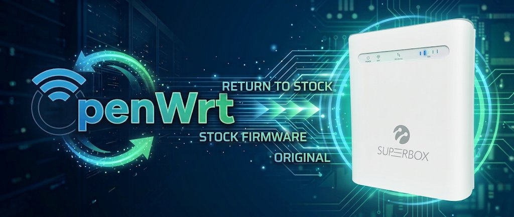
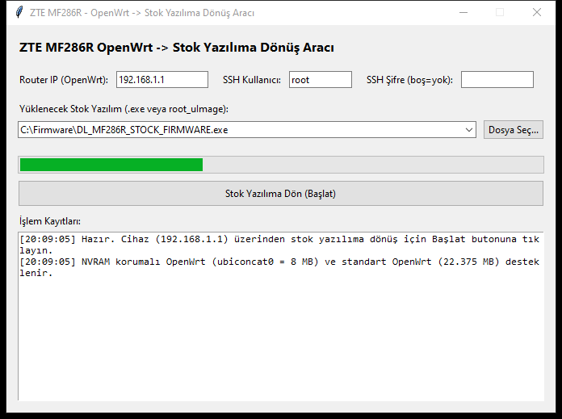

# ZTE MF286R OpenWrt to Stock Firmware Restore Tool



A standalone GUI utility (written in Python / Tkinter and packaged as standalone **64-bit** and **32-bit Windows 7/8/10/11** executables) that restores official **Stock ZTE Firmware** onto a **ZTE MF286R** router currently running **OpenWrt**—directly over a standard Ethernet cable via SSH (`192.168.1.1`), **without requiring UART/Serial access or TFTP recovery**.

> [!IMPORTANT]
> **No Stock ROM / Firmware Files Included:**
> For copyright and redistribution reasons, **this repository does NOT contain or distribute any proprietary ZTE / ISP stock firmware files (`root_uImage` or `DL_MF286R_*.exe`)**.
> To restore stock firmware, please search online and download the official ZTE MF286R stock firmware installer (`.exe`) or `root_uImage` package provided by your ISP/operator (e.g., Turkcell Superbox, Türk Telekom Magnet, Play, T-Mobile, etc.).

---

## Key Features

- **No UART / No Disassembly Needed:** Connects directly to OpenWrt over SSH (`192.168.1.1:22`) and writes the stock NAND partitions (`mtd11` Web, `mtd12` Kernel, `mtd13` RootFS) back to flash.
- **Accepts Stock `.exe` Installers or Raw `root_uImage`:** Automatically extracts `Data\version\root_uImage` (`37 MiB`) directly from any standard ZTE Windows installer `.exe` (7-Zip is bundled inside the executable—no external software required).
- **Supports Both NVRAM-Safe & Standard OpenWrt Layouts:**
  - Automatically detects our **NVRAM-Safe OpenWrt layout** (`ubiconcat0 = 8 MiB` at `0x1000000`, where factory NVRAM in `mtd6..mtd10` was preserved untouched).
  - Also supports **standard upstream OpenWrt layouts** (`ubiconcat0 = 22.375 MiB` at `0x1a0000`), automatically seeking to offset `0xE60000` (`0x1000000`) for the `web` partition and erasing leftover UBI Erase Counter headers so stock YAFFS2 mounts cleanly.
- **Safe RAM-Staged Flashing (`tmpfs`):** Since OpenWrt's running root filesystem (`squashfs`) resides inside `ubiconcat0`, the tool flashes `kernel` (`4 MiB`) and `ubiconcat1` (`25 MiB`) first, then stages `mtd`, `busybox`, and `libc.so` into `/tmp/ram_bin` (`tmpfs` in RAM) to flash `ubiconcat0` (`8 MiB`) and trigger an immediate kernel reboot (`mtd -r`).
- **Windows 7 (32-bit / x86) & Windows 10/11 (64-bit) Builds:** Pre-built standalone executables for both modern 64-bit Windows and legacy 32-bit Windows 7 systems are available in [**Releases**](../../releases).

---

## Download Standalone Executables (GitHub Releases)

Download the pre-built standalone `.exe` files from the [**Releases**](../../releases) page:

| Platform / Architecture | File Name (in Releases) | Size | Notes |
| :--- | :--- | :--- | :--- |
| **Windows 10 / 11 (64-bit / x64)** | `MF286R_OpenWrt_Stok_Donus.exe` | ~15.4 MB | Standalone single-file executable (bundles 64-bit `7z.exe`) |
| **Windows 7 / 8 / 10 / 11 (32-bit / x86)** | `MF286R_OpenWrt_Stok_Donus_32bit.exe` | ~11.0 MB | Built with Python 3.8.10 + PyInstaller 5.13.2 + bundled 32-bit `7z.exe` & UCRT DLLs |

---

## Screenshot



---

## Step-by-Step Restore Tutorial

1. **Obtain a Stock Firmware Package:**
   - Search online for your operator's official ZTE MF286R stock firmware update package (`DL_MF286R_*.exe` or a `38,797,312`-byte `root_uImage` file) and place it on your computer ( ideally in the same folder as the restore tool).
2. **Connect to the OpenWrt Router:**
   - Power on your ZTE MF286R running OpenWrt and connect your computer to one of its **LAN ports** via an Ethernet cable.
   - Verify that the router is reachable at `192.168.1.1`.
3. **Launch the Restore Tool:**
   - Run `MF286R_OpenWrt_Stok_Donus.exe` (or `MF286R_OpenWrt_Stok_Donus_32bit.exe` on 32-bit Windows 7).
   - Enter the router's IP address (default: `192.168.1.1`), SSH username (default: `root`), and SSH password (leave blank if no password is set on OpenWrt).
4. **Select the Stock Firmware & Start:**
   - Select your downloaded stock `.exe` installer (or `root_uImage`) from the dropdown list or click **Dosya Seç... (Browse)** to choose the file.
   - Click **Stok Yazılıma Dön (Başlat)** and confirm the prompt.
5. **Wait for Completion & Automatic Reboot:**
   - **Step 1/3:** Extracts `root_uImage` (`37 MiB`) and flashes the `4 MiB` `kernel` partition (`0x1800000..0x1c00000`).
   - **Step 2/3:** Erases `ubiconcat1` and writes the `25 MiB` `rootfs` payload (`0x1c00000..0x3500000`).
   - **Step 3/3:** Stages the flash binary in RAM (`/tmp/ram_bin`), writes the `8 MiB` `web` partition (`0x1000000..0x1800000`) into `ubiconcat0`, and automatically reboots the router.
   - After ~60 seconds, the router will boot into Stock ZTE Firmware at **`http://192.168.0.1`** or **`http://192.168.1.1`** (depending on the operator firmware—please check the sticker/label on the bottom of your router for the default gateway IP).

---

## Running from Source Code

If you prefer to run the Python script directly from source (`MF286R_OpenWrt_Stok_Donus.py`):

```bash
pip install -r requirements.txt
python MF286R_OpenWrt_Stok_Donus.py
```

*(Note: Ensure [7-Zip](https://www.7-zip.org/) is installed if extracting directly from a stock `.exe` installer when running from source).*

---

## Companion Repository (Stock -> OpenWrt Installer)

Looking to install permanent OpenWrt (23.05.6 or 25.12.6) from stock ZTE firmware in one click? See our companion repository:
- [**zte-mf286r-openwrt-installer**](https://github.com/laserbirdx/zte-mf286r-openwrt-installer)

---

## License

This project and its accompanying tutorial documentation are licensed under the [MIT License](LICENSE).
